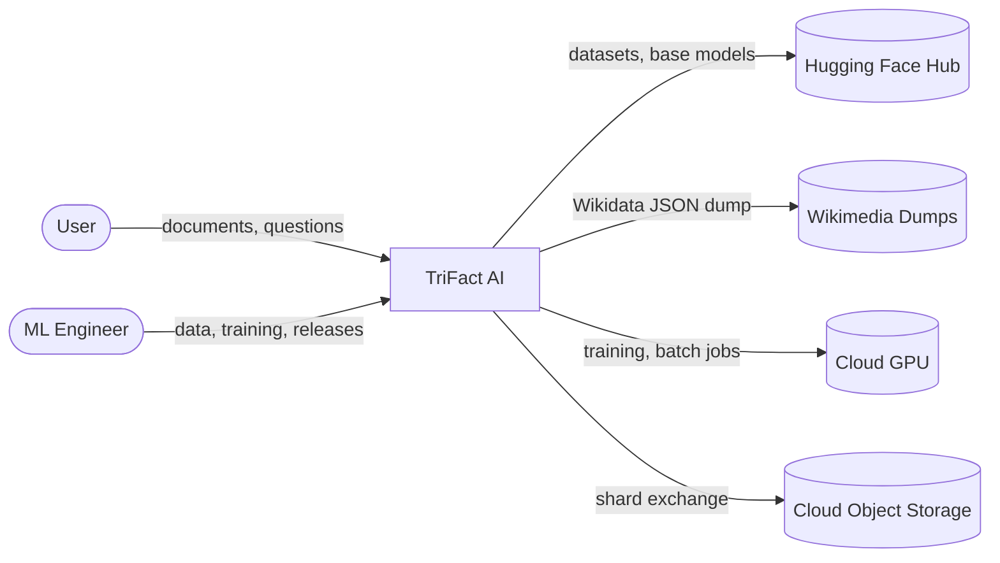
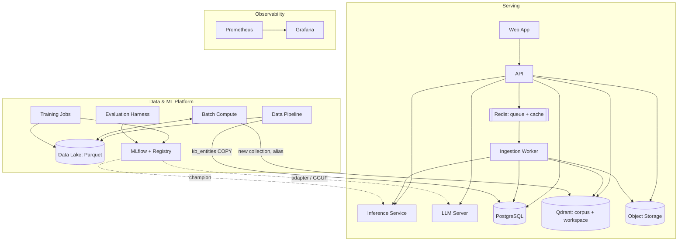
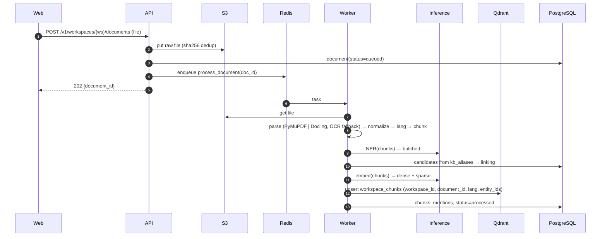

# TriFact AI — Architecture

Multilingual (**KK / RU / EN**) document and knowledge intelligence platform: entity extraction, cross-lingual hybrid retrieval, grounded answers with citations, and claim verification, engineered for **tens of millions** of corpus records.

| Artifact | Location |
|---|---|
| C4 model (source of truth for diagrams) | [`../workspace.dsl`](../workspace.dsl) |
| Exported C4 diagrams | [`../diagrams/`](../diagrams/) |
| Architecture Decision Records | [`../adr/`](../adr/) |
| Stages & done criteria | [`../../ROADMAP.md`](../../ROADMAP.md) |
| Model & dataset catalogs | [`../../research/models.md`](../../research/models.md), [`../../research/datasets.md`](../../research/datasets.md) |
| Canonical Agent Skills | [`../../../.agents/skills/`](../../../.agents/skills/README.md) |

Rule: Never hand-edit `diagrams/*.mmd`. Edit `workspace.dsl`, validate, and export (§15).

---

## 1. Goals, Scale & Constraints

| Dimension | Specification |
|---|---|
| **Target users** | Students and researchers working with KK/RU/EN sources |
| **Document types** | Encyclopedic, educational, popular-science, informational |
| **Core capability** | Question in any of KK/RU/EN → grounded answer in chosen language over sources in any language, with citations and verification verdicts |
| **Trainable ML pillars** | Extraction (NER + Entity Linking), Retrieval (embedder + reranker), Generation (LLM + LoRA), Verification (NLI) |
| **Out of v1 scope** | Relation Extraction, Knowledge Graph construction, legal/medical/financial domains |

- **Scale:** Target volumes live in [datasets.md §6](../../research/datasets.md) (~27M raw docs, ~35M indexed chunks).
- **Scale profiles (`params.yaml: scale.profile`):** `pilot` (150k chunks, 80k NER, 24k SFT, 10k pairs, 3k eval — end-to-end debugging) and `full` (production target). Identical code; parameters only ([AGENTS.md §6](../../../AGENTS.md)).
- **Compute model ([ADR-0025](../adr/0025-cloud-only-computing.md)):** Local PC (RTX 3050 Laptop 4 GB, Ryzen 7 5800HS, 15.4 GB RAM) is the development, Git, CLI control, and local-serving reference host. Heavy EDA, curation, training, HPO, and batch inference run on cloud compute via Google Colab CLI (L4 preferred when available/permitted; cloud CPU for non-GPU stages) and Kaggle CLI (2× T4 fp16). Optional cloud Serving VM hosts the full 35M index (ADR-0013).
- **Non-functional targets (starter, validated in Stage 9):**

| Metric | Target |
|---|---|
| Ask p95 (local, `scope=documents`) | ≤ 6 s; TTFT ≤ 1.5 s |
| Retrieval p95 (excluding reranker) | ≤ 150 ms (workspace); ≤ 500 ms (35M corpus on Serving VM) |
| Text PDF ingestion | ≥ 2 pages/s per worker; hostile files never crash worker |
| Peak RAM (offline stages) | ≤ 10 GB |
| Reproducibility | Any run reconstructible from `git SHA + DVC hashes + config` |

## 2. Architectural Principles

1. **Per-component measurement:** Document Processing, Extraction, Retrieval, Generation, and Verification each have dedicated eval suites and per-language metrics.
2. **Retrieval independent of NER:** Entities are a soft signal and UI filter only ([ADR-0004](../adr/0004-hybrid-retrieval-independent-of-ner.md)).
3. **No unsupported claims:** Every claim carries a `chunk_id`; unverified claims are flagged or replaced by refusal ([ADR-0008](../adr/0008-evidence-verification-and-refusal.md)).
4. **Metric-gated promotion:** Models advance only on frozen tests with statistical significance ([ADR-0009](../adr/0009-model-registry-and-promotion-gate.md)).
5. **Scale-first data plane:** Sharded Parquet + streaming processing ([ADR-0011](../adr/0011-parquet-data-lake.md)), idempotent sharded batch jobs ([ADR-0014](../adr/0014-sharded-batch-jobs.md)); measure throughput and RAM, never assume.
6. **Unified online/offline code:** Normalization, chunking, and model wrappers live in shared `trifact.*` modules to eliminate train/serve skew.
7. **Full reproducibility:** Data in DVC, experiments in MLflow, environments in Docker and `uv.lock`.

---

## 3. System Context (C4 Level 1)



Full diagram: [`diagrams/SystemContext.mmd`](../diagrams/SystemContext.mmd).

## 4. Containers (C4 Level 2)

Three planes communicate exclusively via data stores and Model Registry.



Full diagrams: [`Containers`](../diagrams/Containers.mmd), [`ServingContainers`](../diagrams/ServingContainers.mmd), [`MlPlatformContainers`](../diagrams/MlPlatformContainers.mmd).

| Container | Responsibility | Stack |
|---|---|---|
| **Web App** | Upload, status, streaming chat, citations, entity cards | Next.js, TypeScript |
| **API** | REST + SSE, answer orchestration, audit log | FastAPI, SQLAlchemy, `qdrant-client` |
| **Ingestion Worker** | Parse → OCR → normalize → langid → chunk → NER → link → index | `arq`, PyMuPDF, Docling |
| **Inference Service** | Online encoders (embedder, reranker, NER, NLI) with dynamic batching | FastAPI, PyTorch / ONNX Runtime |
| **LLM Server** | Grounded generation, OpenAI-compatible API | `llama.cpp` (GGUF) / vLLM |
| **PostgreSQL** | App state, logs, Wikidata KB ([ADR-0016](../adr/0016-storage-responsibilities.md)) | PostgreSQL 16, Alembic |
| **Qdrant** | `corpus_chunks` + `workspace_chunks` ([ADR-0013](../adr/0013-two-tier-qdrant-index.md)) | Qdrant 1.20 |
| **Redis** | Job queue, query-embedding and reranker caches | Redis 7 |
| **Object Storage** | Uploads, DVC `local` remote, MLflow artifacts, GGUF | SeaweedFS (S3 API) |
| **Data Lake** | `raw → clean → curated → task → eval` ([ADR-0011](../adr/0011-parquet-data-lake.md)) | Parquet zstd, DVC |
| **Data Pipeline** | CPU DVC stages (acquire, curate, task sets, eval, KB) | Polars, DuckDB, PyArrow, NumPy/SciPy, fastText |
| **Batch Compute** | Sharded jobs: embeddings, mass NER, teacher, indexing ([ADR-0014](../adr/0014-sharded-batch-jobs.md)) | PyTorch, vLLM, ONNX Runtime, `llama.cpp` |
| **Training Jobs** | NER, embedder, reranker, NLI, LoRA LLM; HPO; ≥3 seeds | Transformers, PEFT, sentence-transformers, Optuna |
| **Evaluation Harness** | Metrics, cluster bootstrap, ablation, load tests, gate | `seqeval`, `ranx`, `jiwer`, Locust |
| **MLflow** | Experiment tracking, Model Registry (`champion`/`challenger`) | MLflow 3 |
| **Prometheus + Grafana** | Service/quality metrics and drift alerts | — |

---

## 5. Data Platform

### 5.1 Data Lake Layout

```
data/
  raw/<source>/<lang>/<table>-00000.parquet + raw/<source>/source.yaml  (immutable; table=part if single)
  clean/<source>/<lang>/{part,dropped}-*        + clean/<source>/dataset.yaml, card.md
  curated/dedup/<source>/<lang>/{part,removed}-*
  curated/corpus/<source>/<lang>/{part,contaminated}-* + dataset.yaml, card.md
  task/
    chunks/<source>/<lang>/...                  (same Chunker as online)
    annotations/<model@ver>/<source>/...
    vectors/<embedder@ver>/<source>/...         (dense fp16 + sparse)
    ner/{gold,silver}/<lang>/...
    retrieval/{pairs,negatives}/...
    sft/  nli/  kb/
  eval/<suite>/...                              (frozen; SHA-256 in eval/MANIFEST.yaml, ADR-0007)
```

- Shards: ~1M rows or ≤512 MB, `zstd` compression, partitioned by `source/lang`. Raw acquisition protocol: [ADR-0017](../adr/0017-raw-layer-acquisition-protocol.md).
- **`source.yaml`:** `hf_id`/`url`, pinned `revision`, `license` (`license`, `use`, `release`, `evidence`), `downloaded_at`, `code_version`, input SHA-256s, per-language rows/bytes, `shards`, `row_checks`, `stats` (wall time, throughput, peak RSS). Verify with `python -m trifact.lake verify`.
- **`dataset.yaml` + `card.md`:** input manifests/hashes, `git_sha`, params, stage fingerprint ([ADR-0018](../adr/0018-curation-stages-without-datatrove.md)), row counts, drop reasons, stage metrics, licenses, `release` flag. Dropped/removed/contaminated rows are retained for audit.

### 5.2 Key Parquet Schemas

| Table | Columns |
|---|---|
| `entities` (`raw/wikidata`) | `qid, type, p31: list, p279: list, label_{kk,ru,en,mul}, description_{kk,ru,en,mul}, aliases_{kk,ru,en,mul}: list, sitelink_{kkwiki,ruwiki,enwiki}, n_sitelinks, lastrevid` |
| `documents` (`clean/curated`) | `doc_id, source, domain, lang, lang_score, src_lang, para_lang: list, title, text, url, n_chars, n_words, quality features, minhash_cluster, dup_count, decontaminated_lines` |
| `chunks` | `chunk_id, doc_id, source, lang, ordinal, section, char_start, char_end, text, n_tokens` |
| `vectors` | `chunk_id, dense: fixed_size_list<f16>, sparse_idx: list<u32>, sparse_val: list<f16>` |
| `annotations` | `chunk_id, start, end, surface, type, score, qid, model_version` |
| `ner` | `sent_id, doc_id, lang, tokens: list<str>, tags: list<str>, origin: gold\|silver, source` |
| `retrieval_pairs` | `query_id, query, query_lang, pos_chunk_id, neg_chunk_ids: list<str>, origin` |
| `sft` | `ex_id, question, q_lang, answer_lang, context_chunk_ids, answer, cited_ids, answerable, origin, filters{...}` |
| `nli` | `pair_id, lang, premise, hypothesis, label, origin` |
| `eval/*` | Task schema + `direction` (`q_lang→src_lang`), `verified_by_human` |

### 5.3 Data Pipeline (ROADMAP Stages 1–3)

```
acquire ──► clean ──► dedup ──► decontaminate ──► curated
   │                                   ▲
   │                       eval sources (gold test)
   ▼
wikidata ─────────────────────────────► build_kb ─► PostgreSQL (COPY)
curated ─► chunk_corpus ─► task/chunks ─► [batch] embed_corpus ─► task/vectors ─► [batch] index_corpus
gold ─► validate ─► split ─┬─► build_eval (frozen)
                           ├─► build_ner   (+ Wikipedia links × Wikidata P31 silver)
                           ├─► build_pairs (+ [batch] teacher synthetic queries)
                           ├─► build_sft   (+ [batch] teacher grounded QA)
                           └─► build_nli   (+ [batch] kk MT of XNLI)
```

- **Stage runner (`trifact.data.curation`, [ADR-0018](../adr/0018-curation-stages-without-datatrove.md)):** input-shard units, completion markers, parameter/code/input fingerprints, `curation.workers` processes with capped Polars threads; writes `dataset.yaml`, `card.md`, `reports/<stage>.json`.
- **Normalization (`trifact.ingestion.normalize`):** NFC, Kazakh letters (`ә ғ қ ң ө ұ ү һ і`), Latin/Cyrillic homoglyphs, control-char cleanup; vectorized in Polars.
- **Language ID:** `lid.176` vs. `GlotLID` benchmarked (`reports/langid.json`), selected `curation.langid.model`; tags doc (`lang`, `lang_score`) and paragraphs (`para_lang`).
- **Quality filters (`trifact.data.quality`):** Polars expressions (`default → lang → domain` thresholds calibrated on 500 reviewed docs/lang), boilerplate removal.
- **Dedup (`trifact.data.dedup`):** exact hash + 14×9 MinHash-LSH over word 5-grams; global connected components keeping highest-priority source ([ADR-0019](../adr/0019-dedup-and-decontamination-policy.md)).
- **Decontamination (`trifact.data.decontaminate`):** strips lines with eval 13-grams, drops doc if match crosses lines or >50% chars removed, ignores template grams (>100 docs); re-scan must yield 0 leaks ([ADR-0019](../adr/0019-dedup-and-decontamination-policy.md)).
- **Stats (`trifact.data.corpus_stats`):** funnel `raw → clean → dedup → corpus`, length histograms, mixed-paragraph rate, XLM-R/Qwen3/Qwen3.5 fertility (`reports/corpus_stats.json`).
- **Gold validation, splits & silver/synthetic:** BIO + `answer_start` validation; source-document splits with frozen eval ([ADR-0007](../adr/0007-leakage-safe-splits.md)); filters and license lineage per [ADR-0015](../adr/0015-silver-and-synthetic-data.md).

### 5.4 Versioning

DVC tracks shard directories. Primary persistent store is Google Drive ([ADR-0024](../adr/0024-google-drive-storage.md)); SeaweedFS (`local`) and cloud S3 (`cloud`) are defined in [ADR-0010](../adr/0010-dvc-with-s3-remote.md) and [ADR-0014](../adr/0014-sharded-batch-jobs.md). HF source revisions are pinned by SHA in `params.yaml`.

---

## 6. Online Flows

### 6.1 Document Ingestion



| Step | Design | Rationale |
|---|---|---|
| Parse | `DOC-3` per-page router: PyMuPDF fast path for text/multi-column pages; Docling for tables and scans; native DOCX/HTML/TXT ([ADR-0021](../adr/0021-document-processing-router.md)) | Exact `page`/`section` offsets; Docling is ~100× slower on CPU |
| OCR | Missing/broken text layers only: Docling + Tesseract CLI `kaz+rus+eng` | EasyOCR/RapidOCR lose Kazakh letters; PyMuPDF+Tesseract loses headings/tables |
| Chunk | Sections → sentences → ~350 tokens, ~50 overlap (finalized in Stage 6) | Balances citation precision and context completeness |
| NER + dates | XLM-R (ONNX int8) → `PER`/`ORG`/`LOC`; `DATE` via regex + `dateparser` | [ADR-0006](../adr/0006-unified-ner-label-schema.md) |
| Linking | Normalized alias → `kb_aliases` B-tree + `pg_trgm` → rank by prior × type × context | Maps `Астана` / `Astana` / `Астана қаласы` → single QID |
| Fault isolation | `SafeParser` isolated process (`docproc.limits`: timeout, RSS, size, pages); 3 retries → `failed` with `ParseError.reason` | Hostile/corrupt files never crash worker |

### 6.2 Question → Answer


`scope`: `documents` (default, workspace only), `corpus`, or `all`.

**Response contract**

```json
{
  "answer": "…",
  "answer_lang": "kk",
  "claims": [
    {
      "text": "…",
      "citations": [{"chunk_id": "c_025", "document_id": "doc_001", "page": 4, "quote": "…"}],
      "verdict": "supported | contradicted | not_enough_info",
      "nli_score": 0.93
    }
  ],
  "refused": false,
  "retrieval": {"scope": "all", "candidates": 50, "used": 8},
  "model_versions": {"embedder": "bge-m3@3", "reranker": "reranker@2", "llm": "qwen3.5-2b-lora@4", "nli": "nli@2"},
  "latency_ms": {"retrieve": 80, "rerank": 210, "generate": 1900, "verify": 300}
}
```

**API v1:** `POST/GET/DELETE /v1/workspaces/{ws}/documents[/{id}]`, `POST /v1/ask` (SSE), `GET /v1/entities?q=&type=&lang=`, `GET /v1/entities/{qid}`, `POST /v1/answers/{id}/feedback`, `GET /health`, `GET /metrics`. Workspace API-key auth (single-tenant pet-project threat model).

---

## 7. ML Components

All experiments log per-language metrics to MLflow ([AGENTS.md §6](../../../AGENTS.md)).

### 7.1 Document Processing (Stage 4)

| ID | Configuration | Metrics |
|---|---|---|
| `DOC-0` | PyMuPDF (text layer) | CER/WER, reading order, pages/s |
| `DOC-1` | Docling (layout + tables) | + heading F1, table cell F1 |
| `DOC-2` | `DOC-1` + OCR (Tesseract CLI / EasyOCR / RapidOCR); PyMuPDF + Tesseract | Scan CER by language |
| `DOC-3` | Per-page router: PyMuPDF fast path → Docling on tables/scans | `DOC-1` quality at `DOC-0` speed |
| `OFFICE` | Native DOCX/HTML/TXT vs. Docling backends | Same |

Frozen benchmark `data/eval/docproc` (`build_docproc` / `eval_docproc`, `reports/docproc.json`, MLflow `docproc`). Selection: [ADR-0021](../adr/0021-document-processing-router.md), `params.yaml: docproc`.

### 7.2 Extraction (Stage 5)

Unified core schema `PER`/`ORG`/`LOC` + rule-based `DATE`; `KazNERD-25` is a separate experiment ([ADR-0006](../adr/0006-unified-ner-label-schema.md), `configs/labels.yaml`).

| ID | Model | Goal |
|---|---|---|
| `NER-0` | GLiNER multi v2.1 (zero-shot) | Training-free baseline |
| `NER-1` | XLM-R base on gold | Core supervised baseline |
| `NER-2` | XLM-R base: silver → gold curriculum, HPO, ≥3 seeds | Measure silver contribution |
| `NER-3` | XLM-R large (cloud) | Quality ceiling |
| `NER-4` | `NER-2` + `kk` specialization (`KazNERD-25`) | Unified vs. specialized |
| `NER-5` | Champion → vocab trim + ONNX int8 | Mass-annotation throughput (F1 drop ≤ 0.5 pp) |

- **Metrics & calibration:** strict IOB2 `seqeval` P/R/F1 (`lang × type`), unseen-F1, boundary vs. type errors, CPU/GPU `chunks/s`; per-language temperature scaling and precision–coverage threshold for `annotate_corpus`.
- **Entity Linking:** Wikidata KB (~10M+ filtered entities) → normalized alias B-tree + Kazakh suffix stripping + `pg_trgm` → rank by `prior × type × multilingual context–description similarity`. Report candidate `recall@k`, `accuracy@1`, and NIL rate per language.

### 7.3 Retrieval (Stage 6)

```
query ─► embed (dense + sparse) ─► Qdrant prefetch: dense top-100 ∥ sparse top-100 ─► RRF ─► top-50
       ─► (scope=all: RRF two collections) ─► cross-encoder reranker ─► top-8 ─► LLM
```

| ID | Configuration |
|---|---|
| `RET-0` | BM25 (sparse IDF) |
| `RET-1` | Dense: mE5-large / mE5-large-instruct |
| `RET-2` | Dense: BGE-M3 (dense and dense+sparse) |
| `RET-3` | Dense: Qwen3-Embedding-0.6B (MRL 1024/512/256), 4B (cloud) |
| `RET-4` | Hybrid RRF vs. weighted fusion / DBSF |
| `RET-5` | `RET-4` + reranker (`bge-reranker-v2-m3` / `Qwen3-Reranker-0.6B/4B`) |
| `RET-6` | Fine-tuned embedder (Stage 3 pairs, positive-aware hard negatives, 9-dir balanced) |
| `RET-7` | Fine-tuned reranker (first-stage serving negatives) |
| `RET-C` | Chunking variants (`chunking.variants`) × contextual doc/section headers |
| `RET-S` | Scale ladder `1M → 10M → 35M` × quantization (`none`/`int8`/`binary`/`turbo` + rescore) × HNSW RAM/disk |

- Default embedder: BGE-M3 ([ADR-0003](../adr/0003-bge-m3-default-embedder.md)).
- Metrics across **9 directions**: `Recall@5/10`, `nDCG@10`, `MRR`, first-stage `candidate recall@100`, `judged@10`; `RET-S` adds approximate vs. `exact=true` recall, p50/p95, RAM, disk, build time; plus stage miss attribution.
- **35M corpus memory estimate (1024-d):** fp32 143 GB (unused); fp16 on-disk mmap 72 GB; scalar int8 36 GB (Serving VM); binary 4.5 GB (2.2 GB at MRL 512) in RAM; HNSW level-0 (`m=16`) ~4.5 GB; text payload ~50 GB SSD. Embedder change builds a new collection `corpus_chunks__<embedder>@<ver>` and switches alias post-gate.

### 7.4 Generation (Stage 7)

- **Models ([ADR-0012](../adr/0012-qwen35-lora-generation.md)):** primary `Qwen3.5-2B`, candidates `0.8B`/`4B`/`9B`, control `Qwen3-1.7B`, eval-only NC `KazLLM-8B` / `Sherkala-8B`. Prompt: `configs/prompts/grounded_answer.md`.
- **Training:** cloud Ampere+ GPU **bf16 LoRA** on all linear layers (attention + Gated DeltaNet + MLP, non-thinking mode); never QLoRA, never Kaggle T4. Verify `qwen3_5` compatibility (`transformers`, `PEFT`, `llama.cpp`, `vLLM >= 0.17`) before training.
- **SFT mix:** 60% answerable, 25% cross-lingual, 15% unanswerable (`kk >= 30%`).

| ID | Configuration |
|---|---|
| `GEN-0` | Zero-shot + RAG across all candidates and baselines |
| `GEN-1` | `Qwen3.5-2B` + bf16 LoRA (full mix) |
| `GEN-2` | Mix ablations (no cross-lingual / no unanswerable / gold only) |
| `GEN-3` | Size sweep (`0.8B` vs. `2B` vs. `4B`) on quality–latency curve |
| `GEN-Q` | Serving quantization: GGUF `Q4_K_M`/`Q5_K_M`/`Q8_0` with multilingual `imatrix`, AWQ; KL vs. bf16 + per-lang metrics |

`GEN-1` must beat best `GEN-0` on faithfulness ([ADR-0022](../adr/0022-evaluation-protocol.md)) and answer F1 per language with CI, or serving uses the best baseline.

### 7.5 Evidence Verification (Stage 8)

1. Split answer into atomic claims (rules vs. LLM splitter, benchmarked against human splits).
2. Reject any `[chunk_id]` outside supplied passages.
3. Score `NLI(premise = 2–3 sentence window, hypothesis = claim)`; take max across windows/citations (`quote` = winning window; ADR-0015).
4. Cross-check numbers and dates via rules against winning window; mismatch revokes `supported`.
5. Policy ([ADR-0008](../adr/0008-evidence-verification-and-refusal.md)): drop `contradicted`, flag partial if NEI share exceeds threshold, refuse if zero claims supported. Per-language temperature scaling and risk–coverage thresholds tuned on human-labeled system claims.

| ID | Model |
|---|---|
| `VER-0` | `mDeBERTa-v3-base-xnli` (no `kk` in train) |
| `VER-1` | `bge-m3-zeroshot-v2.0` |
| `VER-2` | Best of `VER-0`/`1` fine-tuned on XNLI `ru`/`en` + `kk` MT + RAG pairs |

---

## 8. Storage Model

Ownership split: [ADR-0016](../adr/0016-storage-responsibilities.md).

- **PostgreSQL (Alembic):** `workspaces`, `documents`, `chunks`, `mentions`, `kb_entities`, `kb_aliases` (B-tree + `gin_trgm_ops`), `queries`, `answers`, `claims`, `citations`, `feedback`.
- **Qdrant:** `corpus_chunks__<emb>@<v>` (alias `corpus_chunks`; dense fp16 on-disk + RAM quant + sparse IDF; payload on-disk; indexes `lang`, `source`, `entity_ids`) and `workspace_chunks__<emb>@<v>` (alias `workspace_chunks`; in-RAM; `workspace_id` with `is_tenant`).
- **Object Storage (SeaweedFS S3):** `trifact-uploads`, `trifact-dvc` (local DVC remote), `trifact-mlflow`, `trifact-serving`.

---

## 9. Offline Compute

- **Cloud-first execution ([ADR-0025](../adr/0025-cloud-only-computing.md)):** Run CPU DVC stages (`dvc.yaml`, peak RAM ≤ 10 GB) and GPU batch/training jobs on cloud infrastructure via Google Colab CLI (NVIDIA L4 preferred when available/permitted; Colab CPU for non-GPU stages) and Kaggle CLI (2× T4 fp16, [ADR-0020](../adr/0020-kaggle-batch-gpu-mt-and-teacher.md)). Persist DVC objects, checkpoints, and MLflow snapshots on Google Drive ([ADR-0024](../adr/0024-google-drive-storage.md)).
- **Sharded batch jobs ([ADR-0014](../adr/0014-sharded-batch-jobs.md)):** `python -m trifact.batch.<job> --shard i/N` (`embed_corpus`, `annotate_corpus`, `teacher_generate`, `index_corpus`) with `_SUCCESS` markers; Stage 3 GPU scripts `jobs/{translate,nli_score,teacher}` run via `trifact.batch.colab` or `trifact.batch.kaggle`.
- **Training:** `python -m trifact.training.<model>` with Optuna HPO and ≥3 seeds.

## 10. Evaluation & Promotion Gate

- **Frozen eval:** built in Stage 3 (`data/eval/MANIFEST.yaml` SHA-256), covering `ner`, `retrieval` (9 directions), `qa`, `nli`, `docproc`, `real_docs` (50–100 real files), `e2e`.
- **Protocol ([ADR-0022](../adr/0022-evaluation-protocol.md)):** cluster paired bootstrap (`params.yaml: evaluation`) + ≥3 seeds; verifier-based faithfulness with human audit; human-calibrated LLM judge only (never sole gate); non-Wikipedia and `real_docs` slices for pretraining contamination; per-example traces logged in MLflow.
- **Promotion gate ([ADR-0009](../adr/0009-model-registry-and-promotion-gate.md)):** thresholds live exclusively in `params.yaml: promotion`:

| Component | Promotion Condition | `promotion.*` Keys |
|---|---|---|
| Extraction | `kk` F1 gain > min (CI > 0), `ru`/`en` drop ≤ max | `ner_kk_f1_min_gain`, `ner_other_max_drop` |
| Retriever / reranker | No regression on any of 9 directions, mean nDCG@10 gain (CI > 0) | `retrieval_no_direction_worse` |
| LLM | Faithfulness ≥ min; answer F1 and faithfulness beat champion per language | `faithfulness_min` |
| Verification | `contradicted` precision ≥ min, ECE ≤ max per language | `verification_contradicted_precision_min`, `verification_ece_max` |
| Cross-lingual | Worst direction gap vs. mean ≤ max | `worst_direction_max_gap` |
| End-to-End | p95 ≤ target, citation accuracy ≥ champion, prompt-injection ASR ≤ champion ([ADR-0023](../adr/0023-untrusted-evidence-in-prompts.md)) | `e2e_p95_latency_s`, `e2e_injection_no_worse` |

- **E2E failure attribution & Stage 9 ablation:** trace each failure to first broken stage (`chunk → retrieval → rerank → prompt budget → answer → citation → verdict`); run ablation `RAG w/o Extraction → + Extraction → + fine-tuned Retrieval → + fine-tuned LLM → + Verification`.

## 11. MLOps

- **MLflow:** domain experiments (`data`, `docproc`, `ner`, `retrieval`, `generation`, `verification`, `e2e`, `batch`) recording git SHA, DVC hashes, config, per-lang metrics, wall time, hardware, and cost.
- **Registry:** `trifact-{ner,embedder,reranker,nli,llm-adapter}` with `champion`/`challenger` aliases; rollback = alias switch (atomic with Qdrant collection alias for embedders).
- **Fitness checks:** pre-commit checks ([AGENTS.md §6](../../../AGENTS.md)) + `tests/test_architecture.py` + `tests/test_skills.py`.

## 12. Observability

- **Signals:** API stage latency/RPS/TTFT/errors; worker queue depth/`failed` reasons/pages/s; inference batch size/GPU/VRAM; Qdrant latency/RAM/segments; answer refusal/`contradicted`/NEI/feedback rates; input drift (question language/length, max retrieval/reranker scores, `ParseError` reasons, OCR share).
- **Drift & alerts:** PSI/JS-divergence against reference window; thresholds calibrated from reference variance; Grafana `Service` and `Quality` dashboards; JSON logs with end-to-end `request_id`. Audited feedback creates **new** versioned eval suites without mutating frozen tests.

## 13. Deployment

- **Local reference stack (`infra/docker-compose.yml`):** Qwen3.5-2B Q4_K_M (~1.4 GB VRAM + KV) + embedder/reranker fp16 (~2.2 GB VRAM, reranker falls back to ONNX int8 CPU); NER/NLI on CPU (~2 GB RAM); Postgres, Qdrant (workspace + corpus subset), Redis, SeaweedFS, MLflow, Prometheus, Grafana (~4–6 GB RAM). `docker compose up -d --wait` waits for all healthchecks; `s3-init` creates buckets.
- **Cloud:** Colab CLI (L4/CPU) and Kaggle CLI (2× T4) for batch/training with Google Drive DVC ([ADR-0025](../adr/0025-cloud-only-computing.md)); optional Serving VM (32–64 GB RAM, 16–24 GB GPU) for full 35M corpus and vLLM.
- Diagrams: [`DeploymentLocal`](../diagrams/DeploymentLocal.mmd), [`DeploymentCloud`](../diagrams/DeploymentCloud.mmd).

## 14. Security & Licensing

- Secrets in `.env` only (never git); `HF_TOKEN` needed for gated `dvc repro`, not `dvc pull`.
- Source license recorded in manifest before use; `release: false` propagates to derivatives (ADR-0015).
- Strict `workspace_id` isolation across PostgreSQL, Qdrant, and S3 with cascading deletes.
- Indirect prompt injection mitigated via spotlighting, tool-less generator, independent output checks, and `eval_e2e` attack suite ([ADR-0023](../adr/0023-untrusted-evidence-in-prompts.md)).

## 15. Repository Layout & C4 Maintenance

Single package `src/trifact/{core,lake,ingestion,extraction,retrieval,generation,verification,api,worker,inference,data,batch,training,evaluation}` with multiple entry points ([ADR-0001](../adr/0001-single-package-multiple-runtimes.md)).

**Updating C4 diagrams:**
1. Edit `docs/architecture/workspace.dsl`.
2. Validate (0 errors): `docker run --rm -v "$PWD/docs/architecture:/usr/local/structurizr" structurizr/structurizr inspect -w /usr/local/structurizr/workspace.dsl`.
3. Export: `python scripts/export_diagrams.py`.
4. Add an ADR if an architectural decision changed.

## 16. Traceability: ROADMAP → Architecture

| Stage | Containers / Components | Modules | DVC / Jobs | ADRs |
|---|---|---|---|---|
| 1 Acquisition | Data Lake, Source Loader, Wikidata Parser | `lake`, `data.acquire`, `data.wikidata` | `acquire`, `wikidata` | 0010, 0011, 0014, 0017, 0024, 0025 |
| 2 Curation | Normalizer, Quality Filters, Dedup, Decontam | `ingestion.normalize`, `data.{clean,dedup,decontaminate}` | `clean`, `dedup`, `decontaminate` | 0011, 0018, 0019 |
| 3 Task Datasets | Splitter, Builders, Teacher Job | `data.{validate,split,build_*}`, `batch.{colab,kaggle}` | `validate`, `split`, `build_*` | 0007, 0015, 0020, 0025 |
| 4 Doc Processing | Worker Parser/OCR/Chunker, DocProc Eval | `ingestion.*`, `data.build_docproc`, `evaluation.eval_docproc` | `build_docproc`, `eval_docproc` | 0001, 0021 |
| 5 Extraction | NER/Date/Linker, KB Builder, Annotate Job | `extraction.*`, `data.build_kb`, `batch.annotate_corpus` | `train_ner`, `eval_ner`, `build_kb` | 0006, 0016 |
| 6 Retrieval | Hybrid Retriever, Embed/Index Jobs, Qdrant | `retrieval.*`, `data.chunk_corpus`, `batch.{embed,index}_corpus` | `train_retriever`, `train_reranker`, `eval_retrieval` | 0002, 0003, 0004, 0013 |
| 7 Generation | LLM Server, Prompt Builder | `generation.*`, `training.train_llm` | `train_llm`, `eval_generation` | 0012 |
| 8 Verification | Evidence Verifier, NLI Endpoint | `verification.*`, `training.train_nli` | `train_nli`, `eval_verification` | 0008 |
| 9 Integration | API, Worker, Inference, Redis, PostgreSQL | `api`, `worker`, `inference` | `eval_e2e`, `gate` | 0009, 0016, 0022, 0023 |
| 10 Product & Ops | Web, Prometheus, Grafana, Deployment | `web/`, `infra/` | — | — |

## 17. Risks & Mitigations

| Risk | Mitigation |
|---|---|
| Weak `kk` cross-lingual retrieval | 9-direction metrics from day 1; KazParC + synthetic pairs; hard negatives |
| Silver/synthetic noise | ADR-0015 filters, human review, data-card drop rates; no unreviewed synthetic in eval |
| 35M index exceeds 15 GB local RAM | Quantization, MRL, on-disk HNSW, `RET-S` ladder, Serving VM |
| Cloud cost (embeddings, teacher, LoRA) | `cloud.budget_usd` gate, pilot first, resumable sharded jobs |
| Immature Qwen3.5 ecosystem (`vLLM`, PEFT, `llama.cpp`) | Stage 7 Step 0 check; `Qwen3-1.7B` control baseline |
| Wikipedia → real-document domain shift | `real_docs` eval (50–100 real files) |
| Unclear dataset licenses | Manifest decision before use; `release: false` propagation |
| Train/test leakage | Document + context splits, decontamination, frozen eval SHA-256 |
| 4 GB local serving VRAM | GGUF Q4, CPU ONNX int8 encoders, cloud training |
| `$0` cloud budget blocks bf16 LoRA (T4 incompatible) | Approve Stage 7 budget first; run `GEN-0` and `GEN-Q` on baselines meanwhile |
| Indirect prompt injection | Spotlighting, independent output validation, `eval_e2e` attack suite (ADR-0023) |
| Biased evaluation (dependent items, `kk` judge, contamination) | Cluster bootstrap, human-calibrated judges, non-Wikipedia & `real_docs` slices (ADR-0022) |
