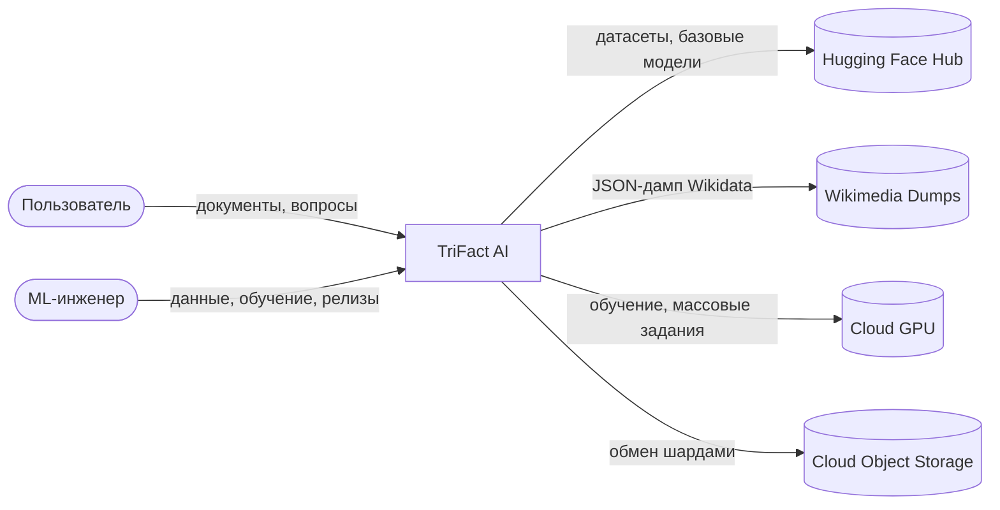
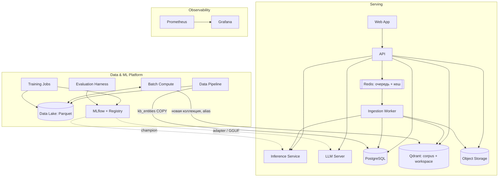
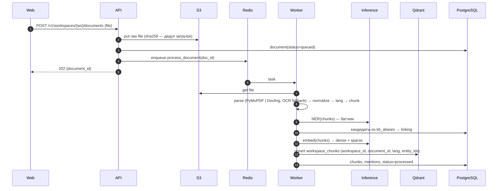
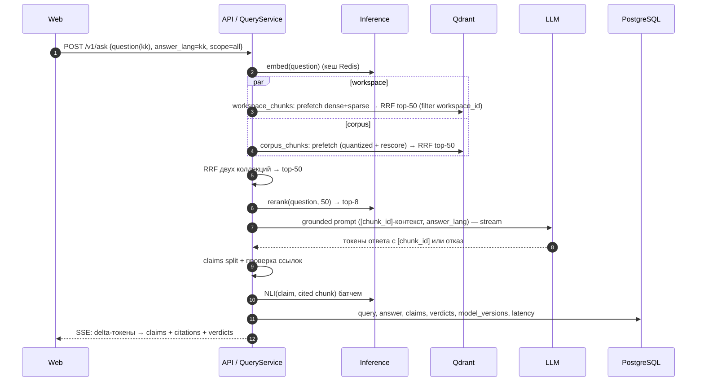

# TriFact AI — архитектура

TriFact AI — мультиязычная (KK / RU / EN) платформа. Она извлекает сущности, ищет доказательства на всех трёх языках, отвечает на вопросы со ссылками на источники и проверяет свои утверждения. Система рассчитана на **десятки миллионов** записей в корпусах и миллионы обучающих примеров.

| Артефакт | Где |
|---|---|
| Модель C4 (источник истины для диаграмм) | [`../workspace.dsl`](../workspace.dsl) |
| Диаграммы, экспортированные из модели | [`../diagrams/`](../diagrams/) |
| Архитектурные решения | [`../adr/`](../adr/) (ADR-0001 … 0017) |
| Этапы и критерии готовности | [`../../ROADMAP.md`](../../ROADMAP.md) |
| Каталоги моделей и данных | [`../../research/models.md`](../../research/models.md), [`../../research/datasets.md`](../../research/datasets.md) |

Правило: диаграммы в `diagrams/` не редактируются вручную. Сначала меняется `workspace.dsl`, затем выполняется проверка и экспорт (§15).

---

## 1. Цели, масштаб, ограничения

| | |
|---|---|
| **Пользователь** | Студенты и исследователи, работающие с источниками на KK/RU/EN |
| **Тип документов** | Энциклопедические, образовательные, научно-популярные, информационные |
| **Главная способность** | Вопрос на одном языке → ответ на выбранном языке по документам на любом из трёх языков, с цитатами и вердиктами проверки |
| **Обучаемые направления** | Extraction (NER + Entity Linking), Retrieval (embedder + reranker), Generation (LLM + LoRA), Verification (NLI) |
| **Вне первой версии** | Relation Extraction, Knowledge Graph, юридические, медицинские и финансовые документы |

**Масштаб**: целевые объёмы по слоям — [datasets.md §6](../../research/datasets.md). Для архитектуры ключевые цифры такие: ~27M документов в raw и ~35M чанков в корпусном индексе.

**Профили масштаба.** Все стадии параметризованы `params.yaml: scale.profile`:

- `pilot` — бюджет исходной концепции: 150k чанков, 80k NER, 24k SFT, 10k пар, 3k eval. Нужен, чтобы быстро прогнать весь цикл от начала до конца и отладить пайплайн.
- `full` — целевой масштаб из таблицы выше.

Код один, меняются только параметры ([AGENTS §6.1](../../../AGENTS.md)).

**Железо.** Локально: RTX 3050 Laptop 4 GB, Ryzen 7 5800HS 8C/16T, 15.4 GB RAM, SSD 663 GB. Всё, что сюда не помещается, выполняется на арендованных GPU (24–80 GB) и, при необходимости, на облачном Serving VM для полного индекса (ADR-0013).

**Нефункциональные цели** (стартовые, подтверждаются в этапе 9):

| Метрика | Цель |
|---|---|
| Ask p95, локально, `scope=documents` | ≤ 6 c; первый токен ≤ 1.5 c |
| Retrieval p95 (без reranker) | ≤ 150 мс для workspace; ≤ 500 мс для корпуса 35M на Serving VM |
| Ingestion текстового PDF | ≥ 2 стр/с на воркер локально; воркер не падает на битых файлах |
| Пиковая RAM офлайн-стадий | ≤ 10 GB (запас под ОС и Docker) |
| Воспроизводимость | любой run восстанавливается по git SHA + DVC-хешам + конфигу |

## 2. Архитектурные принципы

1. **Каждый компонент измеряется отдельно.** У Doc Processing, Extraction, Retrieval, Generation и Verification свои eval и метрики по языкам. Так всегда видно, на каком шаге ошибается система.
2. **RAG не зависит от NER.** Сущности служат только мягким сигналом и пользовательским фильтром ([ADR-0004](../adr/0004-hybrid-retrieval-independent-of-ner.md)).
3. **Ответ без доказательства — не ответ.** У каждого утверждения есть `chunk_id`. Неподтверждённое утверждение помечается или заменяется отказом ([ADR-0008](../adr/0008-evidence-verification-and-refusal.md)).
4. **Модель продвигается только по метрикам** на замороженном тесте, с проверкой значимости ([ADR-0009](../adr/0009-model-registry-and-promotion-gate.md)).
5. **Масштаб закладывается сразу.** Данные хранятся в шардированном Parquet и обрабатываются потоково, без загрузки набора в RAM ([ADR-0011](../adr/0011-parquet-data-lake.md)). Массовые операции выполняются идемпотентными заданиями по шардам ([ADR-0014](../adr/0014-sharded-batch-jobs.md)). Throughput и пиковая память измеряются, а не предполагаются.
6. **Онлайн и офлайн используют один и тот же код.** Нормализация, чанкинг и модели живут в одних модулях `trifact.*`. Онлайн-воркер и офлайн-стадии их импортируют, поэтому обучение и сервинг не расходятся.
7. **Всё воспроизводимо.** Данные версионируются в DVC, эксперименты — в MLflow, окружение — в Docker и `uv.lock`.

---

## 3. Контекст (C4 Level 1)



Полная версия — [`diagrams/SystemContext.mmd`](../diagrams/SystemContext.mmd).

## 4. Контейнеры (C4 Level 2)

Система состоит из трёх контуров. Они взаимодействуют только через хранилища и Model Registry.



Полная версия: [`Containers`](../diagrams/Containers.mmd), а также отдельно [`ServingContainers`](../diagrams/ServingContainers.mmd) и [`MlPlatformContainers`](../diagrams/MlPlatformContainers.mmd).

| Контейнер | Ответственность | Технологии |
|---|---|---|
| **Web App** | Загрузка, статусы, чат со стримингом, цитаты, карточки сущностей | Next.js, TypeScript |
| **API** | REST + SSE, оркестрация ответа, журнал | FastAPI, SQLAlchemy, qdrant-client |
| **Ingestion Worker** | Парсинг → OCR → нормализация → язык → чанки → NER → linking → индексация | arq, PyMuPDF, Docling |
| **Inference Service** | Онлайн encoder-модели: эмбеддинги, reranker, NER, NLI, с динамическим батчингом | FastAPI, PyTorch / ONNX Runtime |
| **LLM Server** | Grounded generation, OpenAI-совместимый API | llama.cpp (GGUF) / vLLM |
| **PostgreSQL** | Состояние приложения, журнал, база сущностей (ADR-0016) | PostgreSQL 16, Alembic |
| **Qdrant** | `corpus_chunks` и `workspace_chunks` (ADR-0013) | Qdrant 1.20 |
| **Redis** | Очередь задач, кеш эмбеддингов запросов и оценок reranker | Redis 7 |
| **Object Storage** | Файлы пользователей, DVC remote `local`, артефакты MLflow, GGUF | SeaweedFS (S3 API) |
| **Data Lake** | Слои raw → clean → curated → task → eval (ADR-0011) | Parquet zstd, DVC |
| **Data Pipeline** | CPU-стадии DVC: загрузка, курация, task-наборы, eval, KB | Polars, DuckDB, PyArrow, numpy/scipy, fastText |
| **Batch Compute** | Шардированные задания: эмбеддинги, массовая NER, учитель, загрузка индекса (ADR-0014) | PyTorch, vLLM, ONNX Runtime |
| **Training Jobs** | NER, embedder, reranker, NLI, LoRA LLM; HPO; ≥ 3 сидов | Transformers, PEFT, sentence-transformers, Optuna |
| **Evaluation Harness** | Метрики, значимость, ablation, нагрузка, гейт | seqeval, ranx, jiwer, Locust |
| **MLflow** | Трекинг, Model Registry (`champion` / `challenger`) | MLflow 3 |
| **Prometheus + Grafana** | Технические метрики и метрики качества, алерты | — |

---

## 5. Платформа данных

### 5.1 Data lake

```
data/
  raw/<source>/<lang>/<table>-00000.parquet + raw/<source>/source.yaml  (не меняется; table = part, если таблица одна)
  clean/<source>/<lang>/{part,dropped}-*  нормализация, язык, фильтры качества   + clean/<source>/dataset.yaml, card.md
  curated/dedup/<source>/<lang>/{part,removed}-*        дедуп внутри и между источниками
  curated/corpus/<source>/<lang>/{part,contaminated}-*  деконтаминация → итоговый корпус   + dataset.yaml, card.md
  task/
    chunks/<source>/<lang>/...             чанки корпуса (тот же Chunker, что онлайн)
    annotations/<model@ver>/<source>/...   упоминания сущностей корпуса
    vectors/<embedder@ver>/<source>/...    dense (fp16) + sparse
    ner/{gold,silver}/<lang>/...
    retrieval/{pairs,negatives}/...
    sft/  nli/  kb/
  eval/<suite>/...                         заморожен, sha256 в eval/MANIFEST.yaml (ADR-0007)
```

Шард — ~1M строк или ≤ 512 MB, сжатие zstd. Партиции — по `source/lang`, внутри — по таблице. Протокол загрузки raw-слоя, колонки происхождения `_config` / `_split` и методы проверки числа строк — [ADR-0017](../adr/0017-raw-layer-acquisition-protocol.md).

**Манифест источника** `source.yaml`: `hf_id` или `url`, `revision` (SHA коммита или дата дампа), `license` (`license`, `use`, `release`, `evidence`), `downloaded_at`, `code_version`, `inputs` (файлы источника с sha256), `rows` и `bytes` по языкам, `shards: [{path, lang, table, rows, bytes, sha256}]`, `row_checks` (метод, ожидаемое, фактическое), `stats` (время, throughput, пиковая RSS). Проверка целостности: `python -m trifact.lake verify`.
**Карточка набора** `dataset.yaml`: входы (манифесты и их хеши), `git_sha`, параметры, отпечаток стадии ([ADR-0018](../adr/0018-curation-stages-without-datatrove.md)), строки по языкам и таблицам, отсев по каждой причине, метрики стадии, лицензии входов, флаг `release`. Рядом — человекочитаемая `card.md` (data card). Отброшенные документы не теряются: таблицы `dropped` (причина + первые `curation.dropped_text_chars` символов), `removed` (ссылка на оставленный дубль), `contaminated` (действие и eval-источники).

### 5.2 Схемы ключевых таблиц (Parquet)

| Таблица | Колонки |
|---|---|
| `entities` (raw/wikidata) | `qid, type, p31: list, p279: list, label_{kk,ru,en,mul}, description_{kk,ru,en,mul}, aliases_{kk,ru,en,mul}: list, sitelink_{kkwiki,ruwiki,enwiki}, n_sitelinks, lastrevid` |
| `documents` (clean/curated) | `doc_id, source, domain, lang, lang_score, src_lang, para_lang: list, title, text, url, n_chars, n_words, признаки качества, minhash_cluster, dup_count, decontaminated_lines` |
| `chunks` | `chunk_id, doc_id, source, lang, ordinal, section, char_start, char_end, text, n_tokens` |
| `vectors` | `chunk_id, dense: fixed_size_list<f16>, sparse_idx: list<u32>, sparse_val: list<f16>` |
| `annotations` | `chunk_id, start, end, surface, type, score, qid, model_version` |
| `ner` | `sent_id, doc_id, lang, tokens: list<str>, tags: list<str>, origin: gold\|silver, source` |
| `retrieval_pairs` | `query_id, query, query_lang, pos_chunk_id, neg_chunk_ids: list<str>, origin` |
| `sft` | `ex_id, question, q_lang, answer_lang, context_chunk_ids, answer, cited_ids, answerable, origin, filters{...}` |
| `nli` | `pair_id, lang, premise, hypothesis, label, origin` |
| `eval/*` | как в task-наборах + `direction` (q_lang→src_lang), `verified_by_human` |

### 5.3 Конвейер данных (этапы 1–3 ROADMAP)

```
acquire ──► clean ──► dedup ──► decontaminate ──► curated
   │                                   ▲
   │                      eval-источники (gold test)
   ▼
wikidata ─────────────────────────────► build_kb ─► PostgreSQL (COPY)
curated ─► chunk_corpus ─► task/chunks ─► [batch] embed_corpus ─► task/vectors ─► [batch] index_corpus
gold ─► validate ─► split ─┬─► build_eval (заморожен)
                           ├─► build_ner   (+ silver из Wikipedia-ссылок × Wikidata P31)
                           ├─► build_pairs (+ [batch] teacher: синтетические запросы)
                           ├─► build_sft   (+ [batch] teacher: grounded QA)
                           └─► build_nli   (+ [batch] teacher: kk-перевод XNLI)
```

- **Раннер стадий** `trifact.data.curation` ([ADR-0018](../adr/0018-curation-stages-without-datatrove.md)): единица работы — входной шард, маркеры готовности, отпечаток параметров/кода/входов, `curation.workers` процессов с ограничением потоков Polars. Каждая стадия пишет `dataset.yaml`, `card.md` и отчёт (`reports/<стадия>.json`) с отсевом, throughput и пиковой RSS.
- **Нормализация** (общий модуль `trifact.ingestion.normalize`): NFC, казахские буквы `ә ғ қ ң ө ұ ү һ і`, гомоглифы латиница/кириллица, мусорные символы. Векторизована на Polars.
- **Определение языка**: fastText lid.176 и GlotLID сравнены на ручной выборке (kk vs ky/tt/ru), выбор по macro-F1 — `reports/langid.json`, модель — `curation.langid.model`. Язык определяется для документа (`lang`, `lang_score`) и для каждого абзаца (`para_lang`).
- **Фильтры качества** (`trifact.data.quality`, выражения Polars): длина, слова, доля букв, замены `�`, повторы строк и n-грамм, средняя длина слова, маркеры списков, многоточия, стоп-слова, boilerplate-строки источника (частотные строки, найденные первым проходом). Пороги `curation.quality` разрешаются как default → язык → домен; подобраны и проверены ручной выборкой 500 документов на язык (`reports/quality_review.json`).
- **Дедупликация** (`trifact.data.dedup`): точный хеш + MinHash-LSH 14×9 над словесными 5-граммами, связные компоненты по всем источникам сразу; оставляется документ приоритетного источника ([ADR-0019](../adr/0019-dedup-and-decontamination-policy.md)).
- **Деконтаминация** (`trifact.data.decontaminate`): строки, содержащие 13-грамму eval-источника, удаляются; документ удаляется целиком, если грама пересекает строки или удалено > 50% символов; шаблонные грамы (> 100 документов) игнорируются; повторный скан выхода обязан дать 0 утечек ([ADR-0019](../adr/0019-dedup-and-decontamination-policy.md)).
- **Статистика** (`trifact.data.corpus_stats`): воронка raw → clean → dedup → corpus, объёмы по источнику/языку/домену, гистограмма длин, доля документов со смешанными абзацами, фертильность токенизаторов XLM-R, Qwen3, Qwen3.5 (`reports/corpus_stats.json`).
- **Валидация gold**: валидность BIO, допустимые метки, `answer_start` указывает на `answer_text`, баланс языков и классов.
- **Сплиты**: по исходному документу. Тест замораживается до любого обучения ([ADR-0007](../adr/0007-leakage-safe-splits.md)).
- **Silver и синтетика**: фильтры, бюджет и родословная лицензий — в [ADR-0015](../adr/0015-silver-and-synthetic-data.md).

### 5.4 Версионирование

DVC отслеживает каталоги шардов. Remote `local` — SeaweedFS, remote `cloud` — S3-бакет облачного провайдера для GPU-заданий ([ADR-0014](../adr/0014-sharded-batch-jobs.md)). Ревизии HF-источников фиксируются в `params.yaml: sources.*.revision` после первой загрузки.

---

## 6. Онлайн-потоки

### 6.1 Загрузка документа



| Шаг | Решение | Обоснование |
|---|---|---|
| Parse | Быстрый путь PyMuPDF для простых PDF, Docling для сложной структуры и таблиц; выбор по бенчмарку этапа 4 | Нужны точные `page` и `section` для цитат; Docling медленнее на порядок |
| OCR | Только для страниц без текстового слоя; Docling OCR / Tesseract `kaz+rus+eng` | Качество на казахских сканах проверяется отдельным мини-бенчмарком |
| Chunk | Секции → предложения → ~350 токенов, перекрытие ~50; окончательный выбор по метрикам retrieval этапа 6 | Компромисс между точностью цитаты и полнотой контекста |
| NER + dates | XLM-R (ONNX int8) → PER/ORG/LOC; DATE — regex + dateparser | [ADR-0006](../adr/0006-unified-ner-label-schema.md) |
| Linking | Нормализованный алиас → кандидаты (`kb_aliases`, приор из ссылок Wikipedia) → ранжирование по типу и контексту | «Астана» / «Astana» / «Астана қаласы» → один QID |
| Устойчивость | Таймаут и лимит страниц на документ, повтор задачи ×3, затем `failed` с причиной | Битые и огромные файлы не роняют воркер |

### 6.2 Вопрос → ответ



`scope`: `documents` (по умолчанию — только рабочее пространство), `corpus` или `all`.

**Контракт ответа**

```json
{
  "answer": "…",
  "answer_lang": "kk",
  "claims": [
    {
      "text": "…",
      "citations": [{"chunk_id": "c_025", "document_id": "doc_001", "page": 4, "quote": "…"}],
      "verdict": "supported | contradicted | not_enough_info",
      "nli_score": 0.93
    }
  ],
  "refused": false,
  "retrieval": {"scope": "all", "candidates": 50, "used": 8},
  "model_versions": {"embedder": "bge-m3@3", "reranker": "reranker@2", "llm": "qwen3.5-2b-lora@4", "nli": "nli@2"},
  "latency_ms": {"retrieve": 80, "rerank": 210, "generate": 1900, "verify": 300}
}
```

**API v1**: `POST/GET/DELETE /v1/workspaces/{ws}/documents[/{id}]`, `POST /v1/ask` (SSE), `GET /v1/entities?q=&type=&lang=`, `GET /v1/entities/{qid}`, `POST /v1/answers/{id}/feedback`, `GET /health`, `GET /metrics`. Аутентификация — API-ключ рабочего пространства. Модель угроз пет-проекта не предполагает многопользовательского SaaS.

---

## 7. ML-компоненты

Идентификаторы экспериментов привязаны к этапам ROADMAP. Каждый run логируется в MLflow с метриками по языкам ([AGENTS §6.3](../../../AGENTS.md)).

### 7.1 Document Processing (этап 4)

| ID | Конфигурация | Метрики |
|---|---|---|
| DOC-0 | PyMuPDF (текстовый слой) | CER/WER, порядок чтения, страниц/с |
| DOC-1 | Docling (layout + таблицы) | + точность заголовков и таблиц |
| DOC-2 | DOC-1 + OCR: Docling OCR vs Tesseract vs EasyOCR | CER на сканах по языкам |
| DOC-3 | Маршрутизатор: быстрый путь → Docling по признакам сложности | качество ≈ DOC-1 при скорости ≈ DOC-0 |

### 7.2 Extraction (этап 5)

- **Схема меток**: общее ядро PER/ORG/LOC на трёх языках, DATE извлекается правилами, KazNERD-25 — отдельный эксперимент ([ADR-0006](../adr/0006-unified-ner-label-schema.md), [`configs/labels.yaml`](../../../configs/labels.yaml)).

| ID | Модель | Цель |
|---|---|---|
| NER-0 | GLiNER multi v2.1, zero-shot | baseline без обучения |
| NER-1 | XLM-R base на gold | основной baseline обучения |
| NER-2 | XLM-R base: silver → gold (curriculum), HPO, ≥ 3 сидов | вклад silver-данных |
| NER-3 | XLM-R large (облако) | потолок качества |
| NER-4 | NER-2 + специализация kk (KazNERD-25) | единая vs специализированная модель |
| NER-5 | champion → обрезка словаря + ONNX int8 | throughput при массовой разметке, просадка F1 ≤ 0.5 п.п. |

- **Метрики**: entity-level P/R/F1 (seqeval) по языку и типу; throughput (чанков/с) на CPU и GPU.
- **Entity Linking**: KB строится из Wikidata — сущности с метками kk/ru/en, алиасы, приоры из ссылок Wikipedia (ожидается порядка 10M сущностей). Генерация кандидатов — точный поиск по нормализованному алиасу в `kb_aliases` (B-tree) с fallback на триграммы (`pg_trgm`). Ранжирование — приор × совместимость типа × сходство контекста. Метрика — accuracy@1 на ручной выборке.
- **Массовая разметка корпуса**: задание `annotate_corpus` записывает `task/annotations`. Отсюда `entity_ids` попадают в payload Qdrant.

### 7.3 Retrieval (этап 6)

```
query ─► embed (dense + sparse) ─► Qdrant prefetch: dense top-100 ∥ sparse top-100 ─► RRF ─► top-50
       ─► (scope=all: RRF двух коллекций) ─► cross-encoder reranker ─► top-8 ─► LLM
```

| ID | Конфигурация |
|---|---|
| RET-0 | BM25 (sparse с IDF) |
| RET-1 | Dense: mE5-large / mE5-large-instruct |
| RET-2 | Dense: BGE-M3 (dense и dense + sparse) |
| RET-3 | Dense: Qwen3-Embedding-0.6B (MRL 1024 / 512 / 256), 4B (облако) |
| RET-4 | Hybrid RRF (лучший dense + лучший sparse) vs взвешенное слияние / DBSF |
| RET-5 | RET-4 + reranker: bge-reranker-v2-m3 / Qwen3-Reranker-0.6B / 4B; top-N по кривой качества и латентности |
| RET-6 | Дообученный embedder (пары этапа 3, hard negatives, межъязыковые пары) |
| RET-7 | Дообученный reranker |
| RET-S | Масштаб: 1M → 10M → 35M × квантизация (none / int8 / binary / turbo + rescoring) × HNSW in-RAM / on-disk |

- **Эмбеддер по умолчанию** — BGE-M3 ([ADR-0003](../adr/0003-bge-m3-default-embedder.md)); challengers из RET-1/RET-3 заменяют его только через гейт.
- **Метрики**: Recall@5/10, nDCG@10, MRR — по **9 направлениям** (язык вопроса × язык источника). Для RET-S дополнительно: latency p50/p95, RAM, время индексации, размер на диске.
- **Бюджет памяти корпуса 35M** (оценка для 1024-d):

| Представление | Размер | Где |
|---|---|---|
| fp32 | 143 GB | не используется |
| fp16 исходные векторы | 72 GB | SSD (mmap), rescoring |
| scalar int8 | 36 GB | только Serving VM |
| binary | 4.5 GB (2.2 GB при MRL 512) | RAM |
| HNSW (m=16, уровень 0) | ~4.5 GB | RAM или on-disk |
| payload (текст ~1.5 KB/чанк) | ~50 GB | SSD |

На ноутбуке вместе с остальным стеком (~4 GB) и моделями на CPU (~2 GB) полный 35M с HNSW в RAM не помещается в 15 GB. Варианты: HNSW on-disk ценой латентности, подмножество корпуса в локальном профиле или облачный Serving VM. Выбор делается по измерениям RET-S ([ADR-0013](../adr/0013-two-tier-qdrant-index.md)).

- **Смена эмбеддера** означает новую коллекцию `corpus_chunks__<embedder>@<ver>`, построенную заданиями `embed_corpus` → `index_corpus`. Alias переключается после гейта.

### 7.4 Generation (этап 7)

- **Модели** ([ADR-0012](../adr/0012-qwen35-lora-generation.md)): цель — Qwen3.5-2B; кандидаты — 0.8B / 4B / 9B; контрольный baseline — Qwen3-1.7B; казахские baseline только для оценки — KazLLM-8B и Sherkala-8B (лицензия NC).
- **Вход**: вопрос, top-k фрагментов с `[chunk_id]`, язык ответа ([`configs/prompts/grounded_answer.md`](../../../configs/prompts/grounded_answer.md)).
- **Цель SFT**: ответ на заданном языке, ссылка `[chunk_id]` после каждого факта, явный отказ, если в контексте нет ответа.
- **Данные**: 1–2M синтетических grounded QA после фильтров (ADR-0015) плюс gold KazQAD / SberQuAD / SQuAD v2. Смесь по умолчанию: 60 % отвечаемых, 25 % межъязыковых, 15 % неотвечаемых. Из этого объёма отбирается обучающее подмножество по качеству и разнообразию.
- **Обучение**: bf16 LoRA (r=16, α=32, attention + MLP) на облачной GPU, режим non-thinking.

| ID | Конфигурация |
|---|---|
| GEN-0 | Zero-shot + RAG: Qwen3.5-0.8B / 2B / 4B / 9B, Qwen3-1.7B, KazLLM-8B, Sherkala-8B |
| GEN-1 | Qwen3.5-2B + LoRA (полная смесь) |
| GEN-2 | Ablation смеси: без межъязыковых / без неотвечаемых / только gold |
| GEN-3 | Лучший размер (0.8B vs 2B vs 4B) по кривой качества и латентности |
| GEN-Q | Квантизация для сервинга: GGUF Q4_K_M / Q5_K_M / Q8_0, AWQ |

**Ключевой эксперимент**: GEN-1 обязан обыграть лучший GEN-0 на независимом тесте по faithfulness и answer F1 на каждом языке. Если не обыграл, fine-tuning не продвигается.

### 7.5 Evidence Verification (этап 8)

1. Ответ делится на атомарные утверждения: правила по предложениям vs LLM-сплиттер.
2. Проверяется, что каждая ссылка `[chunk_id]` есть среди переданных фрагментов.
3. NLI(premise = цитируемый фрагмент, hypothesis = утверждение) → `supported / contradicted / not_enough_info`.
4. Политика: `contradicted` — утверждение удаляется. Если доля `not_enough_info` выше порога, ответ помечается «частично подтверждён». Если подтверждённых утверждений нет, выдаётся отказ.

| ID | Модель |
|---|---|
| VER-0 | mDeBERTa-v3-base-xnli (kk в обучении нет) |
| VER-1 | bge-m3-zeroshot-v2.0 |
| VER-2 | Лучшая из VER-0/1, дообученная на XNLI ru/en + kk-перевод (ADR-0015) |

Метрики: precision/recall вердиктов по языкам, ECE, калиброванные пороги, латентность на ответ.

---

## 8. Модель хранения

Распределение ответственности хранилищ — в [ADR-0016](../adr/0016-storage-responsibilities.md).

### 8.1 PostgreSQL (миграции Alembic)

```
workspaces     (id, name, api_key_hash, created_at)
documents      (id, workspace_id, title, filename, mime, sha256, lang, pages, status, error, uploaded_at, processed_at)
chunks         (id, document_id, ordinal, page, section, char_start, char_end, lang, text, n_tokens)
mentions       (id, chunk_id, surface, type, char_start, char_end, score, qid NULL, model_version)
kb_entities    (qid PK, type, label_kk, label_ru, label_en, description_*, popularity)
kb_aliases     (alias_norm, lang, qid, prior)  -- B-tree на alias_norm, gin_trgm_ops для fallback
queries        (id, workspace_id, question, question_lang, answer_lang, scope, created_at)
answers        (id, query_id, text, refused, model_versions JSONB, latency_ms JSONB)
claims         (answer_id, idx, text, verdict, nli_score)
citations      (answer_id, claim_idx, chunk_id, collection, document_id, page)
feedback       (answer_id, rating, comment, created_at)
```

### 8.2 Qdrant

| Коллекция | Векторы | Хранение | Payload-индексы |
|---|---|---|---|
| `corpus_chunks__<emb>@<v>` (alias `corpus_chunks`) | `dense` (1024 или MRL) + `sparse` (IDF) | исходники on-disk fp16, квантизация в RAM, payload on-disk | `lang`, `source`, `entity_ids` |
| `workspace_chunks__<emb>@<v>` (alias `workspace_chunks`) | то же | in-RAM | `workspace_id` (is_tenant), `document_id`, `lang`, `entity_ids` |

Payload: `chunk_id, document_id, lang, page, section, text, entity_ids[], entity_types[]`.

### 8.3 Object Storage

Бакеты: `trifact-uploads` (исходные файлы), `trifact-dvc` (DVC remote `local`), `trifact-mlflow` (артефакты), `trifact-serving` (GGUF и адаптеры champion).

---

## 9. Офлайн-вычисления

- **CPU-стадии** (Data Pipeline) — DVC-стадии в [`dvc.yaml`](../../../dvc.yaml). Стадии потоковые, пиковая RAM ≤ 10 GB.
- **Batch-задания** (Batch Compute) — `python -m trifact.batch.<job> --shard i/N`: `embed_corpus`, `annotate_corpus`, `teacher_generate`, `index_corpus`. Задания идемпотентны, работают по шардам и пишут маркеры `_SUCCESS` ([ADR-0014](../adr/0014-sharded-batch-jobs.md)).
- **Обучение** — `python -m trifact.training.<model>`. HPO через Optuna (параметры — в `params.yaml`), ≥ 3 сидов для дешёвых моделей.
- **Облако**: тот же образ, `dvc pull` → задание → `dvc push` через remote `cloud`. Бюджет запуска фиксируется в `params.yaml: cloud.budget_usd` заранее.
- **Оценки пропускной способности** (проверить замерами): эмбеддинги класса XLM-R-large на RTX 3050 дают сотни чанков/с, то есть 35M займут несколько суток. На A100/H100 — часы, поэтому корпус кодируется в облаке. NER XLM-R base в ONNX int8 на CPU — порядка сотен–тысяч предложений/с, поэтому массовая разметка тоже идёт в облаке или ночными шардами.

## 10. Оценка и продвижение

- **Замороженный eval** (объём — [datasets.md §6](../../research/datasets.md)): все 9 направлений, собирается в этапе 3 до любого обучения, sha256 хранится в `data/eval/MANIFEST.yaml`.
- **Наборы**: `ner` (gold test по языкам), `retrieval` (вопрос × переводы × золотой фрагмент на исходном языке), `qa` (отвечаемые, межъязыковые, неотвечаемые), `nli`, `docproc` (документы с эталонным текстом), `real_docs` (50–100 реальных документов для оценки переноса), `e2e`.
- **Значимость**: bootstrap CI (1000 ресэмплов) по примерам или ≥ 3 сидов. Улучшение без значимости улучшением не считается.
- **Гейт** ([ADR-0009](../adr/0009-model-registry-and-promotion-gate.md)), пороги в `params.yaml: promotion`:

| Компонент | Условие продвижения |
|---|---|
| Extraction | F1 kk ≥ champion + 3 п.п. (CI > 0), просадка ru/en ≤ 1 п.п. |
| Retriever / reranker | nDCG@10 не хуже champion ни на одном из 9 направлений, среднее лучше (CI > 0) |
| LLM | faithfulness ≥ 0.85, answer F1 и faithfulness лучше champion по каждому языку |
| Verification | precision `contradicted` ≥ порога, ECE ≤ порога |
| Cross-lingual | худшее направление не хуже среднего более чем на 10 % |
| End-to-End | p95 ≤ 6 c (локально), корректность ссылок не ниже champion |

- **Ablation** (этап 9, один и тот же тест): RAG без Extraction → + Extraction-сигналы → + дообученный Retrieval → + дообученный LLM → + Verification.

## 11. MLOps

- **MLflow**: по эксперименту на направление (`data`, `docproc`, `ner`, `retrieval`, `generation`, `verification`, `e2e`, `batch`). В `data` пишутся загрузки и разбор источников. В каждом run: git SHA, DVC-хеши входов, полный конфиг, метрики по языкам и направлениям, время, железо, стоимость.
- **Registry**: модели `trifact-ner`, `trifact-embedder`, `trifact-reranker`, `trifact-nli`, `trifact-llm-adapter`; alias `champion` / `challenger`. Inference и LLM читают `champion` при старте. Откат — перенос alias. Для эмбеддера alias коллекции Qdrant и alias модели переключаются вместе.
- **Качество кода**: проверки перед коммитом — [AGENTS §5](../../../AGENTS.md). Архитектурные тесты (`tests/test_architecture.py`) проверяют, что `trifact.core` ни от чего не зависит, что все команды `dvc.yaml` указывают на существующие модули и что все ADR упомянуты в документации.

## 12. Наблюдаемость

| Сигнал | Метрики |
|---|---|
| API | латентность по стадиям (retrieve / rerank / generate / verify), RPS, ошибки, время до первого токена |
| Worker | длина очереди, длительность по шагам, доля `failed` и причины, страниц/с |
| Модели | размер батча, время инференса, загрузка GPU, VRAM |
| Qdrant | латентность поиска, RAM, сегменты, индексация |
| Качество (из журнала ответов) | доля отказов, доля `contradicted` / `not_enough_info`, распределение языков вопросов, рейтинг фидбека |

Grafana: дашборды «Service» и «Quality», алерты на p95, рост очереди и всплеск `contradicted`. Логи — JSON с `request_id`, сквозным через API → Inference → LLM.

## 13. Развёртывание

**Local** (`docker compose`, [`infra/docker-compose.yml`](../../../infra/docker-compose.yml)):

| Сервис | Где | Память |
|---|---|---|
| LLM Qwen3.5-2B Q4_K_M | GPU | ~1.4 GB VRAM + KV |
| Эмбеддер (fp16) + reranker (fp16) | GPU | ~2.2 GB VRAM; при нехватке reranker уходит на CPU (ONNX int8) |
| NER (ONNX int8), NLI | CPU | ~2 GB RAM |
| PostgreSQL, Qdrant (workspace + подмножество корпуса), Redis, SeaweedFS, MLflow, Prometheus, Grafana | CPU | ~4–6 GB RAM |

У каждого сервиса инфраструктуры есть healthcheck; `docker compose up -d --wait` возвращается, когда все сервисы `healthy`. Одноразовый `s3-init` создаёт бакеты §8.3. Remote `local` для DVC — бакет `trifact-dvc` (`http://localhost:9000`).

**Cloud**: GPU-инстанс для Batch Compute и Training (24–80 GB), S3-бакет как remote `cloud`. Опционально Serving VM (32–64 GB RAM, GPU 16–24 GB) для полного корпуса 35M и vLLM.

Диаграммы: [`DeploymentLocal`](../diagrams/DeploymentLocal.mmd), [`DeploymentCloud`](../diagrams/DeploymentCloud.mmd).

## 14. Безопасность и лицензии

- Секреты хранятся только в `.env` (не в git); `HF_TOKEN` нужен для gated-наборов KazNERD, KazQAD и KazParC.
- Лицензия и решение по ней записываются в манифест каждого источника до использования. Флаг `release: false` наследуется производными наборами (ADR-0015).
- Пользовательские документы изолированы по `workspace_id` в PostgreSQL, Qdrant и S3. Удаление документа каскадно удаляет его чанки и точки.

## 15. Репозиторий и сопровождение модели

```
src/trifact/
  core/          схемы, конфиг, интерфейсы (ни от чего не зависит)
  lake/          раскладка слоёв, манифесты, чтение/запись шардов
  ingestion/     parser, ocr, normalize, langdetect, chunker   (онлайн + офлайн)
  extraction/    ner, dates, linking
  retrieval/     embedder, store (Qdrant), hybrid (RRF), reranker
  generation/    prompt, llm_client
  verification/  claims, citations, nli
  api/ worker/ inference/                                      рантаймы сервинга
  data/          CPU-стадии DVC: acquire, wikidata, clean, dedup, decontaminate, validate, split,
                 build_eval, build_ner, build_pairs, build_sft, build_nli, chunk_corpus, build_kb
  batch/         шардированные задания: embed_corpus, annotate_corpus, teacher_generate, index_corpus
  training/      train_ner, train_retriever, train_reranker, train_nli, train_llm
  evaluation/    eval_docproc, eval_ner, eval_retrieval, eval_generation, eval_verification, eval_e2e, gate
configs/  infra/  web/  docs/  tests/  scripts/
dvc.yaml  params.yaml  pyproject.toml
```

Один пакет, несколько точек входа — [ADR-0001](../adr/0001-single-package-multiple-runtimes.md).

**Изменение архитектуры**:
1. Правка `workspace.dsl`.
2. Проверка: `docker run --rm -v "$PWD/docs/architecture:/usr/local/structurizr" structurizr/structurizr inspect -w /usr/local/structurizr/workspace.dsl` (ноль ошибок) или MCP `structurizr`.
3. Экспорт диаграмм: `python scripts/export_diagrams.py`.
4. ADR, если решение изменилось.

Просмотр интерактивной модели C4 с документацией и ADR на http://localhost:8081: `docker run -it --rm -p 8081:8080 -v "$PWD/docs/architecture:/usr/local/structurizr" structurizr/structurizr local`.

## 16. Трассировка: этапы ROADMAP → архитектура

| Этап | Контейнеры / компоненты | Модули | DVC / задания | ADR |
|---|---|---|---|---|
| 1 Data Platform & Acquisition | Data Lake, Data Pipeline: Source Loader, Wikidata Parser | `lake`, `data.acquire`, `data.wikidata` | `acquire`, `wikidata` | 0010, 0011, 0014, 0017 |
| 2 Data Quality & Curation | Normalizer, Quality Filters, Deduplicator, Decontaminator | `ingestion.normalize`, `data.clean/dedup/decontaminate` | `clean`, `dedup`, `decontaminate` | 0011 |
| 3 Task Datasets | Splitter, NER/Pair/SFT/NLI/Eval Builders, Teacher Job | `data.validate/split/build_*`, `batch.teacher_generate` | `validate`, `split`, `build_*` | 0007, 0015 |
| 4 Document Processing | Worker: Parser, OCR, Chunker; DocProc Eval | `ingestion.*`, `evaluation.eval_docproc` | `eval_docproc` | 0001 |
| 5 Extraction | NER/Date/Linker, KB Builder, Annotate Job | `extraction.*`, `data.build_kb`, `batch.annotate_corpus` | `train_ner`, `eval_ner`, `build_kb` | 0006, 0016 |
| 6 Retrieval at Scale | Hybrid Retriever, Embed/Index Jobs, Qdrant | `retrieval.*`, `data.chunk_corpus`, `batch.embed_corpus/index_corpus` | `train_retriever`, `train_reranker`, `eval_retrieval` | 0002, 0003, 0004, 0013 |
| 7 Generation | LLM Server, Prompt Builder | `generation.*`, `training.train_llm` | `train_llm`, `eval_generation` | 0012 |
| 8 Evidence Verification | Evidence Verifier, NLI Endpoint | `verification.*`, `training.train_nli` | `train_nli`, `eval_verification` | 0008 |
| 9 System Integration | API, Worker, Inference, Redis, PostgreSQL | `api`, `worker`, `inference` | `eval_e2e`, `gate` | 0009, 0016 |
| 10 Product & Ops | Web, Prometheus, Grafana, Deployment | `web/`, `infra/` | — | — |

## 17. Риски

| Риск | Митигирующее действие |
|---|---|
| Слабый межъязыковой поиск для kk | Метрики по 9 направлениям с первого эксперимента; межъязыковые пары из KazParC и синтетики; hard negatives |
| Шум silver и синтетики | Фильтры ADR-0015, ручная выборка, отсев по причинам в data card; eval не строится из синтетики |
| Полный индекс 35M не помещается в 15 GB RAM | Квантизация, MRL, HNSW on-disk, ступени 1M/10M/35M; Serving VM |
| Стоимость облака (эмбеддинги, учитель, LoRA) | Бюджет до запуска, сначала пилот, задания по шардам без потери работы |
| Незрелая поддержка Qwen3.5 (vLLM ≥ 0.17, PEFT, llama.cpp) | Проверка в начале этапа 7; контрольный baseline Qwen3-1.7B |
| Перенос с Wikipedia на реальные документы | Eval `real_docs` (50–100 документов) |
| Неясные лицензии (WikiANN, SberQuAD, NEREL, KazParC, WikiNEuRal) | Решение в манифесте до использования; флаг `release` |
| Утечка train/test | Сплит по документу, деконтаминация, хеш замороженного eval |
| Нехватка VRAM 4 GB | GGUF Q4, encoder-модели на CPU (ONNX int8), обучение в облаке |
